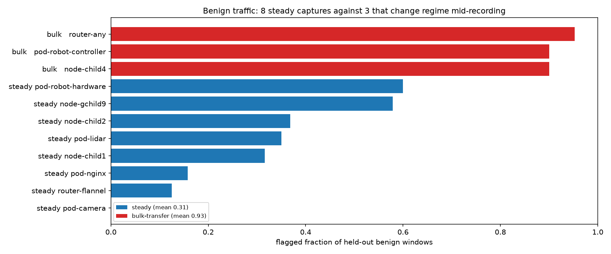
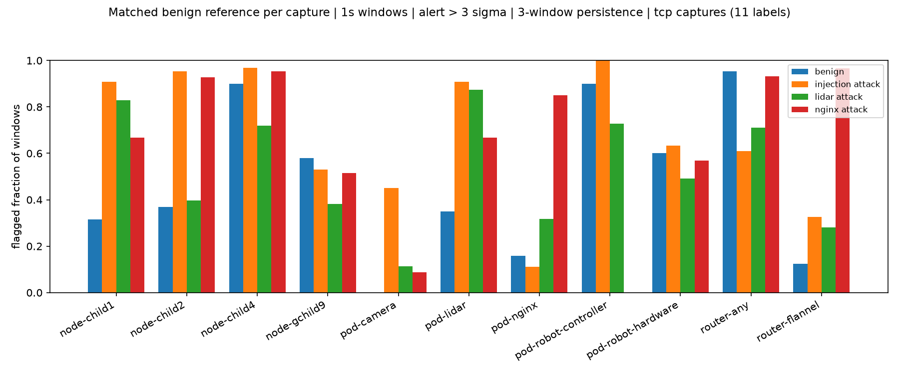
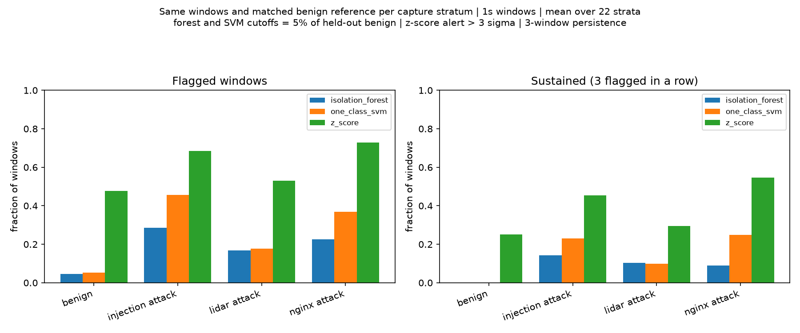
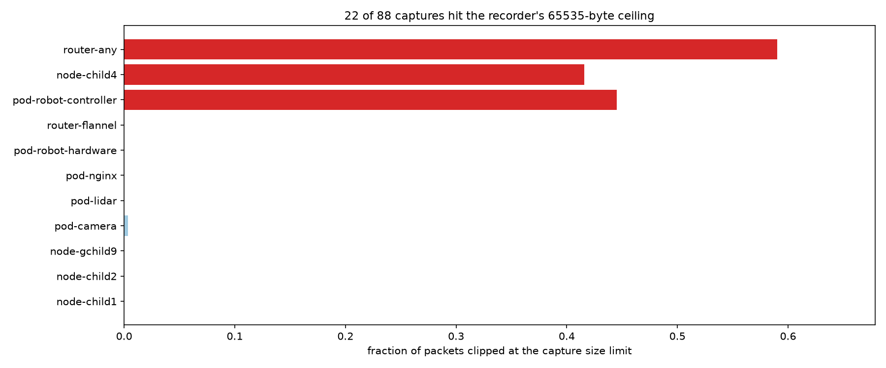
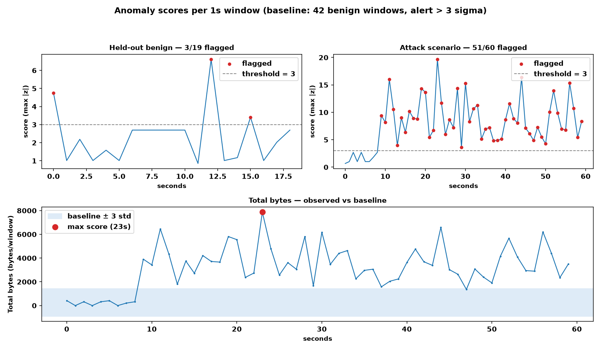

# Threat detection on the offline captures

## The correction that changes how these numbers read

Earlier drafts called the high flag rates on a few capture points a calibration problem. It is not. 3 of 11 benign vantages contain a bulk-transfer regime change: normal traffic steps from tens of KB/s to hundreds of MB/s partway through the recording and stays there. Across both capture methods the detector flags 0.93 of held-out windows on those captures and 0.31 on the other 8 (max 0.65). A step change in normal traffic is something the detector is supposed to notice, so a per-vantage cutoff would suppress a real change in the cluster rather than remove a false alarm.

## Which measurements carry the false alarms

Mean flagged fraction per feature group, tcp captures, held-out benign windows.

| group | benign all 11 | benign steady (8) | benign bulk-transfer (3) |
|---|---|---|---|
| diversity | 0.11 | 0.10 | 0.14 |
| flags | 0.09 | 0.08 | 0.12 |
| protocol | 0.23 | 0.21 | 0.28 |
| size_timing | 0.47 | 0.37 | 0.77 |
| volume | 0.45 | 0.34 | 0.75 |

`volume` and `size_timing` carry the detection and all of the false alarm. Every other group stays at or below 0.28 on the drifting captures. That is a property of raw byte counts rather than of the cutoff, so recalibrating the threshold would not fix it. The scale-free measurements already in the feature set — `http_frac`, `mean_packet_size` — do not have this failure mode, and `sweep.py --groups diversity,flags,protocol` is the one-command test of whether detection survives without the length features. Per-capture numbers: `outputs/ablation_results.csv`.

## Detection per scenario

Steady captures only, 1s windows, alert above 3 sigma. Per capture: `outputs/sweep_results.csv`.

| scenario | flagged fraction |
|---|---|
| nginx attack | 0.66 |
| injection attack | 0.62 |
| lidar attack | 0.46 |

## The recorder's size limit

22 of 88 captures have at least 1% of their packets sitting on the recorder's 65535-byte ceiling, up to 60% of packets clipped. Those captures are exactly the three vantages that change regime, so their length-based measurements are not comparable to the other 66. They stay in the results, with the clipped share recorded per capture as `at_snaplen` in `outputs/capture_manifest.csv` rather than scored as if intact.

## One capture end to end

## Method

Each recording is cut into 1-second slices and summarised by 13 measurements. What normal looks like is learned from a benign recording only, with its last 30% held back as an honest check, so no detector is graded on the seconds it learned from. Each slice is scored by its largest deviation from that baseline, and an alert requires 3 flagged slices in a row. The baseline is a median and a MAD rather than a mean and standard deviation: a mean/std pair is set by the bulk-transfer windows instead of by normal traffic. Regenerate everything in this file with `sweep.py`, `compare.py`, and `walkthrough.py`.

