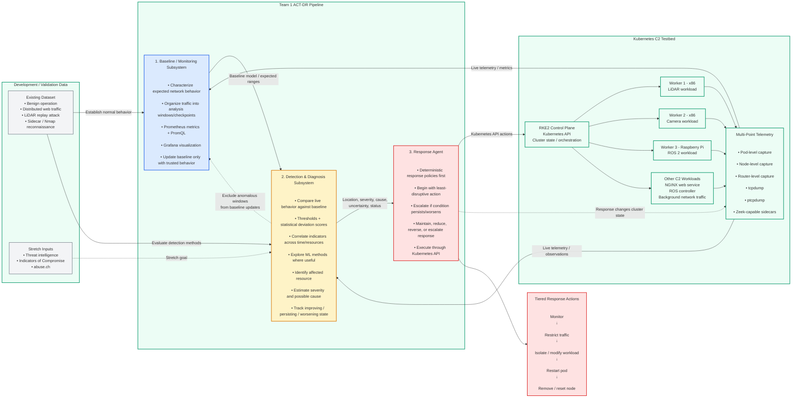

# Team 1 ACT-DR Architecture

Automated Network-Threat Diagnosis and Response — pipeline, testbed, and data flow.

## Reading the diagram

- **Subsystems 1–3** (blue / amber / red) are the three Team 1 deliverables. Subsystem 2 (`Threat_Detection/`) is the detector/diagnoser between the baseline and the response agent.
- **Kubernetes C2 Testbed** (green) is where the pipeline runs: an RKE2 control plane over three workers (two x86, one Raspberry Pi) plus the C2 workloads.
- **Solid arrows** are primary data flow; **dashed arrows** are stretch inputs and feedback loops.
- The **response feedback** loop is the part that closes the architecture: the response agent's actions change cluster state, which is observed by the same telemetry feeding the baseline, and anomalous windows are excluded from baseline updates so the detector does not learn the attack as normal.
- **Tiered response actions** run least-disruptive to most: monitor → restrict traffic → isolate/modify workload → restart pod → remove/reset node.
