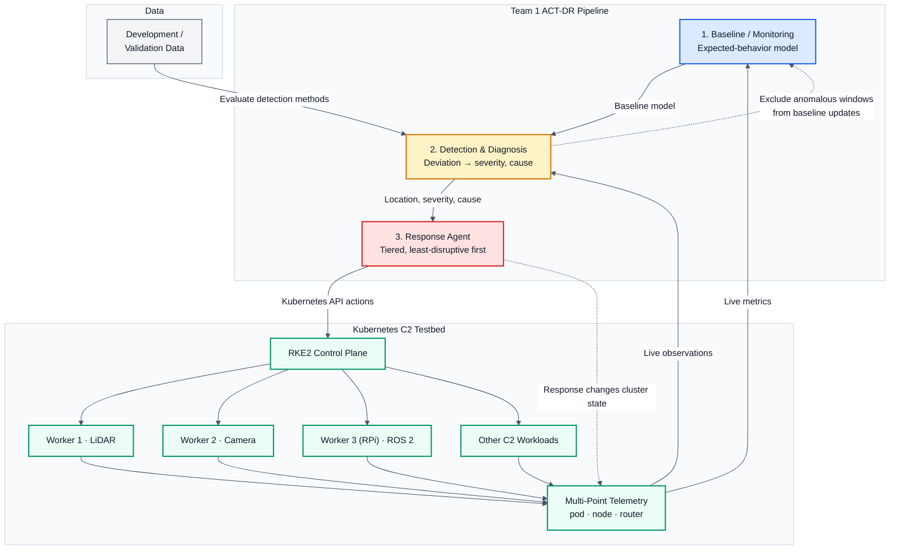

# Team 1 ACT-DR Architecture

Automated Network-Threat Diagnosis and Response — pipeline, testbed, and data flow.

## Reading the diagram

- **Subsystems 1–3** (blue / amber / red) are the three Team 1 deliverables. Subsystem 2 (`Threat_Detection/`) is the detector/diagnoser between the baseline and the response agent.
- **Kubernetes C2 Testbed** (green) is where the pipeline runs: an RKE2 control plane over three workers (two x86, one Raspberry Pi) plus the C2 workloads. `Multi-Point Telemetry` is the collection point that feeds the pipeline.
- **The baseline is fed only by live cluster telemetry** (`Multi-Point Telemetry` → `Baseline / Monitoring`). The development dataset feeds the detector only, for evaluating detection methods, and is not a second input to the baseline.
- **Solid arrows** are primary data flow; **dashed arrows** are feedback loops. The response agent's actions change cluster state, which the same telemetry observes, and anomalous windows are excluded from baseline updates so the detector does not learn the attack as normal.

## Exported assets

Rendered from the Mermaid block above, for pasting into documents and slides.

| File | Format | Size | Use |
|---|---|---|---|
| [`act-dr-architecture.svg`](act-dr-architecture.svg) | vector | 1432 × 909 viewBox | Documents and print — scales without blurring |
| [`act-dr-architecture.png`](act-dr-architecture.png) | raster @2× | 2864 × 1818 px | Slides — white background included |

Aspect ratio is **1.58:1** (landscape). How it fits common formats:

| Target | Scale | Rendered | Body text |
|---|---|---|---|
| 16:9 slide (1920×1080) | 1.19× | 1702 × 1080 | 17.8 px |
| 16:10 slide (1280×800) | 0.88× | 1261 × 800 | 13.2 px |
| 16:9 slide (1280×720) | 0.79× | 1135 × 720 | 11.9 px |
| 4:3 slide (1024×768) | 0.72× | 1024 × 650 | 10.7 px |
| Letter page, 7 in wide | 0.73× | 1050 × 666 | 11.0 px |

For a 16:9 deck, drop the PNG in and size it to the slide height; it fills the height and leaves narrow side margins.

## Rendering notes

These are measured, not assumed.

- **Landscape by construction.** The figure is laid out as two horizontal bands (pipeline on top, testbed below) rather than one left-to-right chain. A single-row layout gave a 2644 × 990 viewBox (2.67:1), which scaled down hard enough to make text illegible on a 4:3 slide; the two-band layout lands at 1.58:1.
- **Node labels are deliberately terse.** The figure previously carried every requirement bullet, which forced a 3199 px wide canvas — GitHub scaled that to 0.32×, shrinking 16 px text to roughly 5 px. Requirements live in this document; the diagram carries structure.
- **Light theme is pinned.** The block sets `theme: base` with explicit `themeVariables`, and every `classDef` sets an explicit `color:`. GitHub re-themes Mermaid to match its own light/dark setting; without the pin, label text inherits a theme colour that clashes with the light box fills and the figure becomes unreadable in dark mode. All 50 labels clear WCAG AA (4.5:1) in both light and dark; worst case is 14.5:1.
- **`cluster` is a reserved class name.** Mermaid uses `.cluster` internally for subgraph boxes, so a `classDef cluster` silently repaints *every* subgraph in the diagram. The Kubernetes component class is therefore named `k8snode`.
- `direction` inside a subgraph is ignored when edges enter those nodes from outside. That is expected Mermaid behaviour, not a defect in this diagram.
