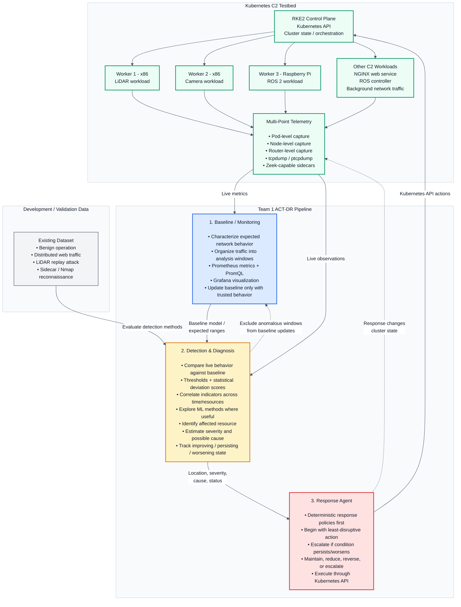

# Team 1 ACT-DR Architecture

Automated Network-Threat Diagnosis and Response — pipeline, testbed, and data flow.

## Reading the diagram

- **Subsystems 1–3** (blue / amber / red) are the three Team 1 deliverables. Subsystem 2 (`Threat_Detection/`) is the detector/diagnoser between the baseline and the response agent.
- **Kubernetes C2 Testbed** is where the pipeline runs: an RKE2 control plane over three workers (two x86, one Raspberry Pi) plus the C2 workloads. The green boxes are cluster components; the enclosing subgraph is deliberately neutral so it reads as a container, not a subsystem.
- **The baseline is fed only by live cluster telemetry** (`Multi-Point Telemetry` → `Baseline / Monitoring`). The development dataset now feeds the detector only, for evaluating detection methods, and is no longer a second input to the baseline.
- **Solid arrows** are primary data flow; **dashed arrows** are feedback loops. The response agent's actions change cluster state, which the same telemetry observes, and anomalous windows are excluded from baseline updates so the detector does not learn the attack as normal.

## Rendering notes

Both workarounds below were measured, not assumed.

- **Pinned light theme.** The diagram sets `theme: base` with explicit `themeVariables`, and every `classDef` carries an explicit `color:`. GitHub re-themes Mermaid to match its own light/dark setting; without the pin, label text inherits a theme colour that clashes with the light box fills and the figure becomes unreadable in dark mode. All 50 labels now clear WCAG AA (4.5:1) in both light and dark, worst case 14.5:1.
- **`cluster` is a reserved class name.** Mermaid uses `.cluster` internally for subgraph boxes, so a `classDef cluster` silently repaints *every* subgraph in the diagram. The Kubernetes component class is named `k8snode` for that reason.
- **Layout is `flowchart TB`, not `LR`.** The original horizontal layout rendered a 3199px-wide SVG that GitHub scaled to 0.32×, shrinking 16px text to roughly 5px — the main cause of the "hard to read" symptom. The current layout is 1353px wide and scales to 0.75×.
- `direction` inside a subgraph is ignored when edges enter those nodes from outside, so the subgraphs keep their inherited direction. That is expected Mermaid behaviour, not a defect in the diagram.
